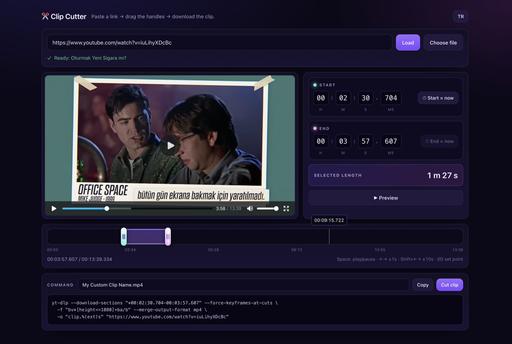

# Clip Cutter · YouTube klip kesici

**Paste a YouTube link → drag two handles → download the exact clip.**
Free, open source, no signup, no ads, no uploads. Everything runs on your own machine.



---

## What it does (in plain words)

You know that one 40-second moment in a 90-minute video? Clip Cutter grabs **only that moment**.

1. Paste the YouTube link.
2. The video appears in the page — drag the **green handle** to the start and the **pink handle** to the end.
3. Hit **Cut clip**. You get an MP4 of just that part, in full quality.

You see and hear the video while you choose, so you never guess timestamps.

---

## Why is a server needed?

Because a web page is not allowed to do the two hard parts:

| Job | Who can do it | Why the browser can't |
|-----|---------------|-----------------------|
| Get the video stream from YouTube | `yt-dlp` | YouTube never allows another site to read its streams (CORS), and stream URLs are signed and expire. |
| Cut frame-accurately | `ffmpeg` | No browser API can cut a video file without re-uploading it somewhere. |

So `server.py` (20 KB of Python, no dependencies beyond `yt-dlp` + `ffmpeg`) does both locally.
Your files never leave the machine. The public GitHub Pages demo is therefore **preview-only** — it shows the interface with a sample video and explains what the server adds.

---

## Run it locally

You need Python 3.9+, [`yt-dlp`](https://github.com/yt-dlp/yt-dlp) and `ffmpeg`:

```bash
# macOS
brew install yt-dlp ffmpeg

git clone https://github.com/pemre/clip-cutter-youtube
cd clip-cutter-youtube
python3 server.py
```

Then open **http://localhost:8917**.

On Linux: `sudo apt install ffmpeg python3 && pipx install yt-dlp` (or `pip install yt-dlp`).

### Using it

| You want to… | Do this |
|---|---|
| Pick the start | Drag the green handle, or type in the START boxes, or press `I` at the moment you want |
| Pick the end | Same with the pink handle / END boxes / `O` |
| Nudge by a hair | `↑` `↓` in a time box (one unit), `Shift+↑↓` (ten units) |
| Check your cut | `▶ Preview` plays from the start point |
| Name the file | Type it in the box next to **Copy** |
| Get the clip | **Cut clip** → progress bar → **Download** |
| Use it elsewhere | **Copy** gives you the ready `yt-dlp` command |

**Keyboard:** `Space` play/pause · `←` `→` ±1s · `Shift+←/→` ±10s · `I` start here · `O` end here

Interface language: **TR / EN** toggle, remembered in your browser.

---

## How it works (for the curious)

```
browser ──▶ server.py
              ├─ /api/preview  ── yt-dlp: small 360p copy, cached in ./cache/  → <video> scrubbing (17–37 ms seeks)
              ├─ /api/cut      ── yt-dlp --download-sections --force-keyframes-at-cuts  → ./out/<name>.mp4
              └─ /api/job      ── progress %, polled by the page
```

* The preview copy is small on purpose: scrubbing must feel instant. The final clip is always rendered at up to 1080p from the original stream.
* Handles, keyboard nudges and file names all go through the same `setSide()` state function — one source of truth for start/end.
* No frameworks, no build step, no `node_modules`. One HTML file, one Python file.

---

## FAQ

**Does it download the whole video?** Only once, a small preview copy per video (a 78-minute film ≈ 147 MB at 360p). If you already know the timestamps you can skip the UI entirely and use the copied command — that fetches just the range.

**Quality loss?** No. The clip is cut from the original stream (`--force-keyframes-at-cuts` re-encodes for exact cut points).

**Private / age-restricted videos?** Same rules as `yt-dlp`: only public videos work.

**Windows?** `server.py` is plain stdlib Python — `py server.py` works if `yt-dlp` and `ffmpeg` are on PATH.

**Is it legal?** It is a tool, like a pair of scissors. Respect YouTube's terms and the rights of the people who made the video.

---

MIT licensed. Built by [@pemre](https://github.com/pemre) because trimming a video shouldn't need an account, an upload, or a watermark.
